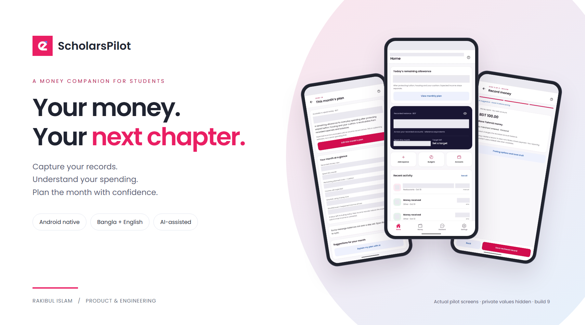
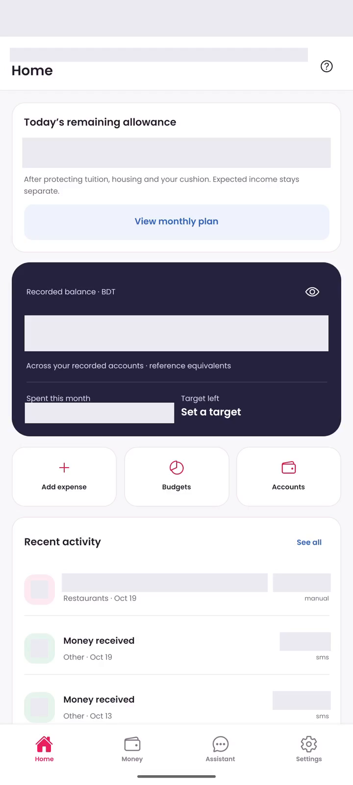
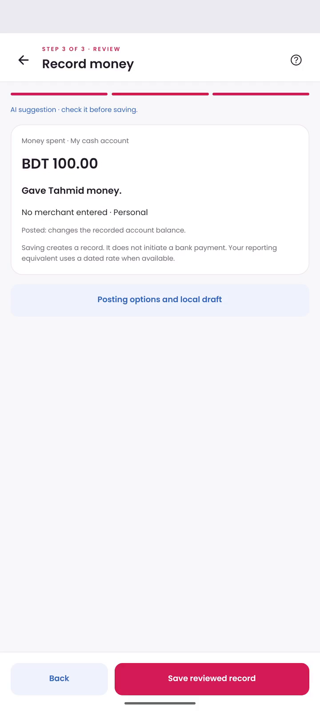
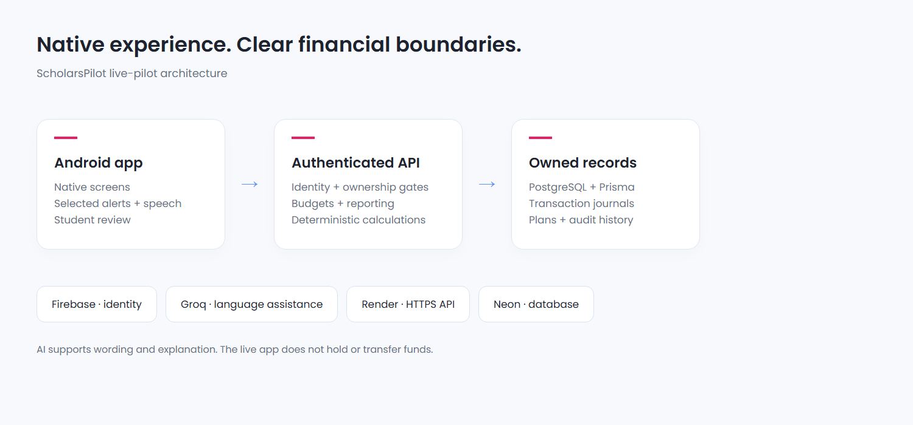

# ScholarsPilot

## A student money companion, from record to daily plan

**Product and engineering case study** · Rakibul Islam · 21 October 2026 
**Android pilot:** version 1.0.0, build 9 · **Verification reference:** 20 October 2026

## The problem

A student can have money in a bank, a mobile wallet and cash, while expecting income that has not yet arrived. Tuition, housing and daily purchases all draw on that money. Financial evidence is scattered across messages and notifications, and the purpose behind a payment is often lost. A visible balance alone cannot explain what remains available for the rest of the month.

ScholarsPilot addresses that gap through an Android application that combines records, reviewed explanations and a monthly plan. Its initial pilot serves students in Bangladesh aged 13 and above, with guardian approval required for users under 18. Education profiles also represent domestic, international and online study contexts.

## The product loop

**Capture → understand → review → plan.** Supported financial messages and optional wallet alerts reduce repetitive entry. Students supply short reasons for payments by text or voice. AI improves wording and suggests a category; the student can review and edit the result. Recorded spending then informs category budgets and the monthly view.

This is a record-management workflow rather than a bank connection. It does not require bank passwords or payment PINs. Missing events can still be entered manually. A notification that says only “Cash Out” is treated as a prompt for review, not as evidence of an amount that was never provided.

## A native experience with four destinations

Home presents recorded balances, activity and a calculated daily allowance. Money groups account records, activity, category budgets and reporting. Assistant handles student-finance questions and explanations. Settings holds profile details, capture permissions, the widget, privacy and the guide.

The design uses white surfaces, a restrained pink primary accent, blue support accents and locally bundled Poppins typography. The four-tab structure keeps daily actions accessible while longer forms remain within native screens. The configurable widget brings a selected subset of balance, today's spending and daily allowance onto the home screen, subject to Android launcher confirmation.

## Purposeful records and voice entry

The amount explains how much; the student's reason explains why. A short recipient-only statement is a valid description. AI wording should preserve that meaning rather than inventing a purpose, repayment or missing detail.

English and Bangla dictation use the phone's speech-recognition service. Matching on-device recognition is preferred where available; external phone-service processing is disclosed and requires consent. The speech choice is remembered on that phone. ScholarsPilot does not persist raw audio recordings. The transcript becomes text for review and, when enabled and available, AI-assisted wording/category preparation.

The reviewed suggestion remains editable before Save. Ordinary record creation, amounts and financial calculations do not depend on a language model. The photographed description example is an unsaved demonstration entry, not a claimed real expense.

## Planning with money that exists

The monthly plan covers tuition, housing, living costs, other spending, a protected cushion and expected income. It distinguishes whole-month targets from what has already been spent. It protects remaining essentials before calculating flexible daily spending room over the remaining calendar days.

Expected income stays separate until received. An incomplete plan does not produce an invented allowance. This makes the daily number a transparent planning estimate rather than a promise that a scholarship or allowance will arrive.

Records retain their original currency. The preferred reporting currency can differ from the student's location: for example, a student spending USD may choose BDT for summaries. Dated reference conversions support reporting while preserving original amounts; missing rates produce incomplete totals rather than guessed values. A reporting rate is not a bank's executable exchange quote.

## Selective automation and incomplete evidence

After Android permission and in-app setup, students choose financial senders and review an initial current-month import. Multiple senders are supported. Shared bank senders can map account suffixes to different records; a single wallet inbox can operate without account digits. Recognized OTP/security messages and promotions are filtered.

A separate optional listener handles supported alerts from the official bKash application. This is notification capture, not access to private wallet history or a bKash account API. Missing amounts and fees require student input. Cash Out records a transfer of principal into cash with the actual fee as spending, rather than counting the entire withdrawal as consumption.

Permission restrictions vary across Android installations. Some sideloaded apps cannot receive the requested SMS or notification access. Manual entry and reviewed records remain available. Even with permission, messages may be late, incomplete or misleading; the app's records are not an independently bank-verified live balance.

## Engineering architecture

The native client uses Expo, React Native and Expo Router. A Kotlin module integrates financial alerts and the compact Android widget. The client communicates with a Next.js/TypeScript API over HTTPS. Prisma manages PostgreSQL records on Neon, and Firebase supports hosted identity and email verification. Render hosts the API. The documented AI path uses a Groq-hosted model.

Financial services own record updates, currency arithmetic, budgets and reporting. Model tools retrieve authorized context and support explanations. Authentication, ownership checks and applicable email/consent gates are enforced server-side. Amounts use integer currency minor units with decimal arithmetic where conversions require it. Journals and user-scoped idempotency controls support consistency and duplicate protection.

This public showcase distributes documentation and the signed pilot artifact, not application source or server credentials. Free service tiers have quotas and availability limits, so infrastructure sustainability remains part of the release roadmap.

## AI with a defined role

The Assistant answers money-management questions, explains authorized records and supports hypothetical budget discussions. A zero balance is not a reason to refuse general guidance. Hypothetical amounts should remain separate from a student's saved plan and actual balances.

AI also helps produce readable transaction wording and a suggested category. It does not transfer funds, silently change a student's budget or invent financial evidence. Deterministic history queries and ordinary calculations can operate without model inference. Bounded context, task routing, request limits and reusable explanations reduce unnecessary model calls.

An additional engineering prototype compares fictional BDT/USD tuition routes and runs a Financial Safety Twin against scholarship delays, deadlines and reserve requirements. Its exact-approval and simulated-ledger workflow is separate from the downloadable live Android pilot. No live tuition transfer is offered by this APK.

## Privacy and student control

SMS, microphone and notification access are separate optional system permissions. The student selects the financial sources to process, reviews descriptions and can use manual entry instead. Raw audio persistence is disabled. Some speech recognition and AI text processing can involve external providers after the relevant disclosure/consent; this is not an entirely offline application.

Email verification and applicable guardian approval gate access to live financial records. Age/residency declarations and guardian email approval are not equivalent to independent identity verification. The broader release still requires privacy, minor-user safeguard and security review. This report does not claim independent certification or complete end-to-end encryption of every record.

Screens in this report are actual Pixel 6a / Android 16 captures with private financial values hidden. Screens show interface behavior and should not be read as evidence that a new real bank event occurred during the capture.

## Verification and release status

| Recorded check, 20 October 2026 | Result | Scope |
|---|---|---|
| Automated suite | 188 passed across 28 files | Local finance, authorization, reporting, parsing and related integration behavior; some external services mocked |
| Controlled financial scenarios | 8 passed | Fictional practice funds, including approval, duplicate, shortfall and invoice defenses |
| Complete browser workflow | 1 passed | Local practice invoice-to-receipt workflow; not a native-device suite |
| Root and mobile static checks | Lint and TypeScript passed | Source-level checks |
| Signed v9 APK | Signature/package/alignment checks passed | Existing ARM64 release artifact, 23 native libraries checked |
| Documented phone | Pixel 6a, Android 16 | Pilot interface/voice-review evidence; not all-device acceptance |

These are scoped results, not a performance benchmark, coverage percentage or independent security audit. A new genuine bKash Cash Out/Send Money event was not induced end to end for the referenced evidence. Broader financial-sender and device validation remains open.

Version 1.0.0, build 9 supports ARM64 Android 7.0 and above, with target SDK 36. The signed APK is 43,670,848 bytes. Its SHA-256 is:

`aab3da25c7df039cc0fd7b3298ba78ccf5dcfc312f13f8f7b7fe4eed7e354773`

APK upgrades are manual and should be installed over the existing application. The hosted API is configured, so a PC development server is unnecessary. Free hosting may need time to wake and AI availability depends on quotas.

## Next milestones

The next priorities are broader consenting-device and message-format validation, clearer reconciliation for incomplete history, accessibility review, improved operational monitoring and independent privacy/security assessment. Any future financial-account API integration must use an approved provider path; message/manual recording remains valuable for students who do not connect a bank.

The current contribution is a practical connection between financial evidence, understandable purposes and a daily student plan—with explicit boundaries around what the app can infer and what remains the student's decision.

**Created by Rakibul Islam.** Support: rakibul.rir06@gmail.com 
[Download and release details](https://github.com/RakibulIslam1/scholarspilot-downloads/releases/tag/pilot-1.0.0-9)
