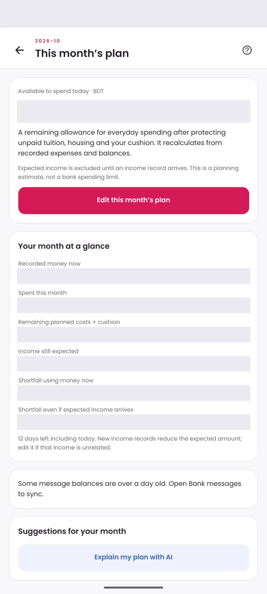
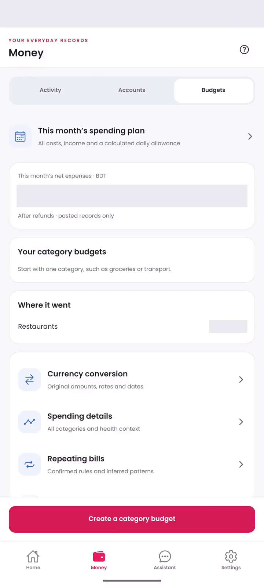
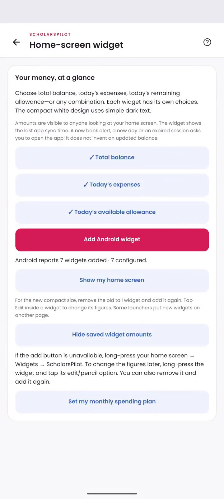
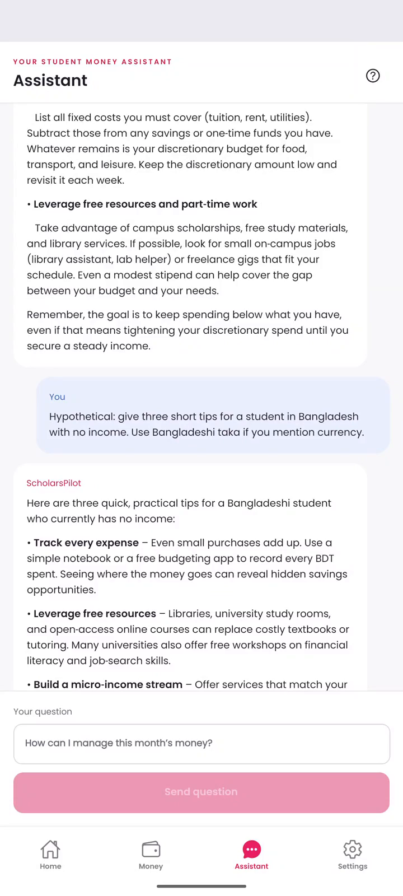

# ScholarsPilot Screen Gallery

Actual Pixel 6a / Android 16 captures. Financial values are hidden. The description review is an unsaved demonstration entry.

## Home

A daily entry point for recorded money, activity and allowance.

## Monthly plan

Protect essentials and keep expected income separate from current funds.

## Description review

Review meaningful wording and a suggested category before saving.

## Budgets

Keep category budgets and reporting tools together in Money.

## Widget preferences

Choose which metrics the widget displays; Android confirms home-screen placement.

## Assistant

Ask student money questions and understand records.

